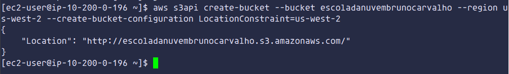
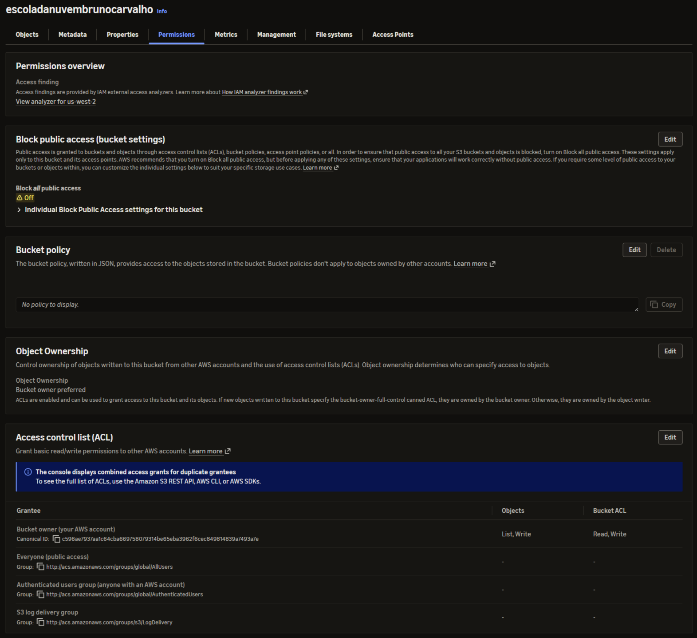
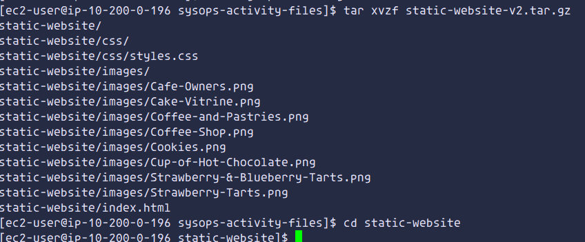
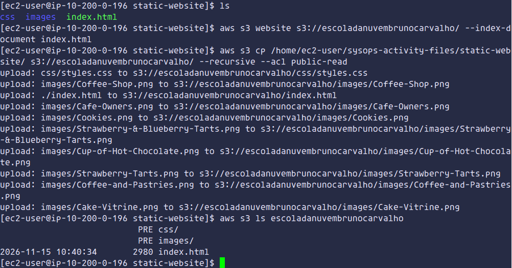
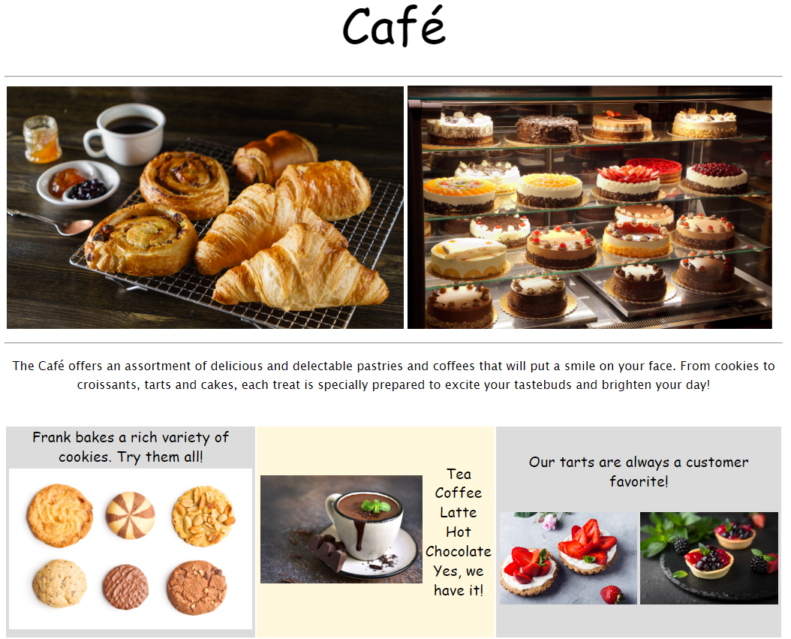

# Lab 7 - Lab 170 - Criando um Website no Amazon S3

## Visão geral

Neste laboratório, pratiquei a criação e configuração de um bucket no Amazon S3 para hospedar um website estático. Também utilizei o AWS CLI para realizar operações no bucket e desenvolvi um script para facilitar a atualização dos arquivos do site.

## Atividades realizadas

### 1. Criação do bucket no Amazon S3

Utilizei o AWS CLI para criar um bucket no Amazon S3, configurando a região `us-west-2`.

### 2. Configuração das permissões do bucket

Ajustei as configurações de acesso público e habilitei as ACLs para permitir que os arquivos do website fossem acessados publicamente.

### 3. Preparação dos arquivos do website

Extraí os arquivos do website estático e verifiquei sua estrutura, incluindo o arquivo principal `index.html`, folhas de estilo e imagens.

### 4. Hospedagem e publicação do website

Habilitei a hospedagem de site estático no bucket e utilizei o AWS CLI para enviar os arquivos ao Amazon S3.

Após a publicação, acessei o website pelo endpoint de hospedagem estática disponibilizado pelo Amazon S3.

### 5. Atualização do website com script

Criei o script `update-website.sh` para automatizar o envio dos arquivos ao bucket. Também realizei alterações visuais na página e executei o script para publicar as atualizações.

## O que aprendi

- Criar e configurar buckets utilizando o AWS CLI.
- Configurar permissões de acesso público no Amazon S3.
- Habilitar a hospedagem de websites estáticos.
- Publicar arquivos de um site diretamente em um bucket S3.
- Utilizar comandos AWS CLI para gerenciar arquivos armazenados no S3.
- Criar scripts Bash para automatizar tarefas de atualização de websites.

## Página do projeto

[**Acessar GitHub Pages**](https://brunogacarvalho.github.io/lab-170-criando-website-amazon-s3/)

A página apresenta um resumo do laboratório e flashcards interativos para revisar os principais conceitos.

## Créditos

Laboratório realizado durante a formação em Computação em Nuvem (AWS re/Start) da **Escola da Nuvem**.

- Professor: [Raphael Ohlsen](https://br.linkedin.com/in/raphael-ohlsen)
- Instituição: [Escola da Nuvem](https://escoladanuvem.org/) | [LinkedIn da Escola da Nuvem](https://www.linkedin.com/school/escola-da-nuvem/)

Laboratório realizado como parte da formação em Computação em Nuvem AWS.
